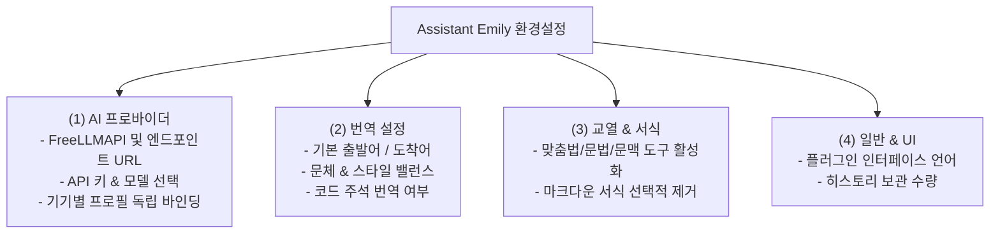
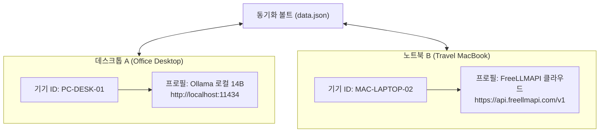

# [제2편] FreeLLMAPI 연동 및 AI 프로바이더·기기별 프로필 설정 매뉴얼

> **Assistant Emily** 는 **FreeLLMAPI** 를 최우선 핵심 AI 프록시(Primary & Default)로 탑재하도록 설계되었습니다. 34개 이상의 무료 LLM(월 74억 토큰)을 단일 키로 제로 비용에 활용할 수 있으며, 오프라인 환경을 위한 로컬 온디바이스 AI(Ollama) 및 표준 OpenAI 호환 엔드포인트도 유연하게 연결할 수 있습니다. 여러 기기를 오가며 작업할 때 설정 충돌 없이 최적화하는 기기별 프로필 관리법을 안내합니다.

---

## 📌 설정 화면 구조 (4대 독립 서브탭)

옵시디언의 `설정 > Assistant Emily` 로 이동하면 목적에 따라 세분화된 4개의 독립 탭을 확인할 수 있습니다:



---

## 1단계: 프로바이더별 맞춤 연결 설정

### 1. FreeLLMAPI (1순위 핵심 AI 프록시 — Primary & Recommended)

**FreeLLMAPI** 는 Assistant Emily의 가장 본질적인 심장입니다. 개인 컴퓨터에 고성능 GPU가 없더라도, 전 세계 34개 이상 AI 제공자의 무료 티어(월 약 74억 토큰, 635개 엔드포인트)를 단 하나의 일원화된 엔드포인트로 통합하여 완전 무료로 제공합니다.

1. **엔드포인트 준비**: FreeLLMAPI 클라우드 서비스 엔드포인트를 사용하거나, 로컬 Docker/Node.js로 직접 구동합니다.
2. **설정값 입력**: 옵시디언 `설정 > Assistant Emily > AI 프로바이더` 로 이동하여 다음 정보를 입력합니다:
   * **API Base URL**: `https://api.freellmapi.com/v1` (로컬 자체 호스팅 시: `http://localhost:3000/v1`)
   * **API Key**: 발급받은 FreeLLMAPI 인증 토큰(`flm_...`)을 입력합니다.
   * **Model Name**: 원하는 모델을 입력합니다.
     * `dots-3-note-preview:free` (노트 정리, 요약 및 가벼운 번역에 최적)
     * `gemini-2.5-flash` (초고속 응답 속도 및 장문 컨텍스트 완벽 처리)
     * `deepseek-chat` (탁월한 한국어 어휘 구사력 및 논리적 추론 품질)
3. **[연결 테스트]** 버튼을 클릭하여 `✓ 연결 성공` 뱃지를 확인합니다.

---

### 2. Ollama (오프라인 로컬 온디바이스 AI 대안)

인터넷 연결이 완전히 차단된 오프라인 환경이나, 개인 고성능 GPU를 갖추고 데이터의 물리적 외부 유출을 100% 방지하고자 하는 사용자를 위한 로컬 백엔드 대안입니다.

1. [Ollama 공식 홈페이지](https://ollama.com) 에서 Ollama를 다운로드하여 설치합니다.
2. 터미널을 열고 원하는 로컬 모델을 다운로드합니다:
   ```bash
   # 고품질 다국어 마크다운 번역 모델 (RAM 16GB 이상 권장)
   ollama run qwen2.5:14b

   # 가벼운 경량 모델 (RAM 8GB 환경)
   ollama run llama3.1:8b
   ```
3. Assistant Emily 설정의 **[AI 프로바이더]** 탭에서 입력합니다:
   * **API Base URL**: `http://localhost:11434/v1` (또는 `http://127.0.0.1:11434/v1`)
   * **API Key**: 비워둡니다 (로컬 통신이므로 키가 필요 없습니다).
   * **Model Name**: `qwen2.5:14b`
4. **[연결 테스트]** 를 눌러 정상 응답을 확인합니다.

---

### 3. 기타 OpenAI 호환 엔드포인트 (부가 지원)

Assistant Emily는 글로벌 업계 표준인 OpenAI API 인터페이스 규격을 완벽히 준수합니다. 따라서 사내 자체 AI 프록시나 외부 호환 엔드포인트를 연동해야 하는 경우, 해당 엔드포인트의 **API Base URL**, **API Key**, **Model Name** 을 입력하여 자유롭게 활용하실 수 있습니다.

---

## 2단계: 기기 프로필(Device Profile) 스마트 바인딩

### 문제 배경: 클라우드 보관함 동기화 시 발생하는 설정 충돌
OneDrive, Google Drive, iCloud, 또는 Obsidian Sync를 통해 여러 대의 컴퓨터(예: 집의 고성능 데스크톱과 외출용 노트북)에서 동일한 옵시디언 볼트를 사용할 때, 플러그인 설정 파일(`data.json`)이 동기화되면 충돌이 발생합니다:
* **집 데스크톱**: 로컬 Ollama (`http://localhost:11434`, 모델: `qwen2.5:14b`)
* **외부 노트북**: 클라우드 FreeLLMAPI (`https://api.freellmapi.com/v1`, 모델: `gemini-2.5-flash`)
* 동기화가 이뤄지면 노트북에서 데스크톱의 `localhost` 를 호출하여 연결 오류(`ECONNREFUSED`)가 발생합니다.

### 해결책: Assistant Emily의 기기별 독립 격리 바인딩
Assistant Emily는 각 하드웨어마다 고유한 기기 ID(`deviceId`)를 자동 발급하고, 볼트가 동기화되더라도 현재 기기에 매핑된 전용 프로필만 독립적으로 읽고 씁니다.



### 기기 프로필 관리 방법
1. `설정 > Assistant Emily > AI 프로바이더` 로 이동합니다.
2. 상단의 **[기기별 프로필 관리]** 영역을 확인합니다.
3. 현재 사용 중인 기기에 적합한 이름을 지정하거나 새 프로필을 추가합니다.
4. 특정 기기에서 설정을 수정해도 다른 컴퓨터의 로컬 연결 정보는 전혀 손상되지 않습니다.

---

## 3단계: 실시간 헬스 체크 및 모델 목록 갱신

1. 설정 창에서 **[연결 테스트]** 버튼을 누르면 플러그인이 엔드포인트와 실제 통신하여 지연 시간(Ping)과 응답 가능 여부를 즉시 검증합니다.
2. 엔드포인트가 `/v1/models` 표준 조회를 지원하는 경우, 모델 입력창 우측의 **[모델 목록 새로고침]** 버튼을 눌러 현재 서버에서 제공하는 사용 가능한 모델 목록을 드롭다운으로 즉시 불러올 수 있습니다.

---

## 🚀 다음 단계

AI 연결을 성공적으로 마치셨다면, 이제 실전 번역 기능과 단축키를 활용하는 방법을 살펴보세요:

* ➡️ **[제3편: 스마트 마크다운 번역 & 단축키 실전 활용 매뉴얼](03-translation-and-hotkeys.md)**
