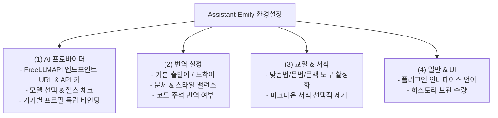
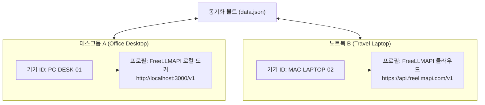

# [제2편] FreeLLMAPI 연동 및 기기별 프로필 설정 매뉴얼

> **Assistant Emily** 는 **FreeLLMAPI** 전용으로 설계된 AI 마크다운 페어 어시스턴트입니다. 전 세계 34개 이상의 무료 LLM(월 약 74억 토큰, 635개 엔드포인트)을 단 하나의 키로 제로 비용에 활용하며, 여러 기기를 오가며 작업할 때 설정 충돌 없이 최적화하는 기기별 프로필 관리법을 안내합니다.

---

## 📌 설정 화면 구조 (4대 독립 서브탭)

옵시디언의 `설정 > Assistant Emily` 로 이동하면 목적에 따라 세분화된 4개의 독립 탭을 확인할 수 있습니다:

---

## 1단계: FreeLLMAPI 연결 설정

### FreeLLMAPI 핵심 개요
**FreeLLMAPI** 는 Assistant Emily의 유일한 전용 AI 프록시입니다. 개인 컴퓨터에 고성능 GPU가 없더라도, 수십 개 글로벌 AI 기업의 무료 티어를 일원화된 엔드포인트로 묶어 무제한 수준의 고품질 번역과 교열을 완전 무료로 제공합니다.

1. **엔드포인트 준비**:
   * 공식 클라우드 엔드포인트: `https://api.freellmapi.com/v1`
   * 로컬 자체 호스팅(Docker): `http://localhost:3000/v1`
2. **설정값 입력**:
   * 옵시디언 `설정 > Assistant Emily > AI 프로바이더` 로 이동합니다.
   * **API Base URL**: `https://api.freellmapi.com/v1` 입력
   * **API Key**: 발급받은 FreeLLMAPI 인증 키(`flm_...`) 입력
   * **Model Name**: 원하는 모델을 입력합니다.
     * `dots-3-note-preview:free` (노트 요약 및 가벼운 번역에 최적)
     * `gemini-2.5-flash` (초고속 응답 속도 및 장문 컨텍스트 처리)
     * `deepseek-chat` (탁월한 한국어 어휘력 및 문맥 추론)
3. **연결 확인**:
   * **[연결 테스트]** 버튼을 클릭하여 `✓ 연결 성공` 녹색 뱃지를 확인합니다.

---

## 2단계: 기기 프로필(Device Profile) 스마트 바인딩

### 문제 배경: 클라우드 보관함 동기화 시 설정 충돌 방지
OneDrive, Google Drive, iCloud, 또는 Obsidian Sync를 통해 여러 대의 컴퓨터(예: 집 데스크톱과 이동용 노트북)에서 동일한 옵시디언 볼트를 사용할 때, 기기마다 다른 FreeLLMAPI 엔드포인트(예: 사내 도커 vs 외부 클라우드)나 모델을 지정하더라도 충돌이 발생하지 않도록 보호합니다.

### 해결책: Assistant Emily의 기기별 독립 격리 바인딩
Assistant Emily는 각 하드웨어마다 고유한 기기 ID(`deviceId`)를 자동 발급하고, 볼트가 동기화되더라도 현재 기기에 매핑된 전용 프로필만 독립적으로 읽고 씁니다.

### 기기 프로필 관리 방법
1. `설정 > Assistant Emily > AI 프로바이더` 로 이동합니다.
2. 상단의 **[기기별 프로필 관리]** 영역에서 현재 기기에 맞춤 이름을 지정합니다.
3. 특정 기기에서 모델이나 엔드포인트를 변경해도 다른 기기의 설정은 전혀 손상되지 않습니다.

---

## 3단계: 실시간 헬스 체크 및 모델 목록 갱신

1. 설정 창에서 **[연결 테스트]** 버튼을 누르면 FreeLLMAPI 서버와 즉시 통신하여 연결 지연 시간과 상태를 검증합니다.
2. 모델 입력창 우측의 **[모델 목록 새로고침]** 버튼을 누르면 현재 FreeLLMAPI 서버에서 제공하는 사용 가능한 최신 모델 목록을 드롭다운으로 즉시 불러올 수 있습니다.

---

## 🚀 다음 단계

FreeLLMAPI 연결을 성공적으로 마치셨다면, 이제 실전 번역 기능과 단축키를 활용하는 방법을 살펴보세요:

* ➡️ **[제3편: 스마트 마크다운 번역 & 단축키 실전 활용 매뉴얼](03-translation-and-hotkeys.md)**
