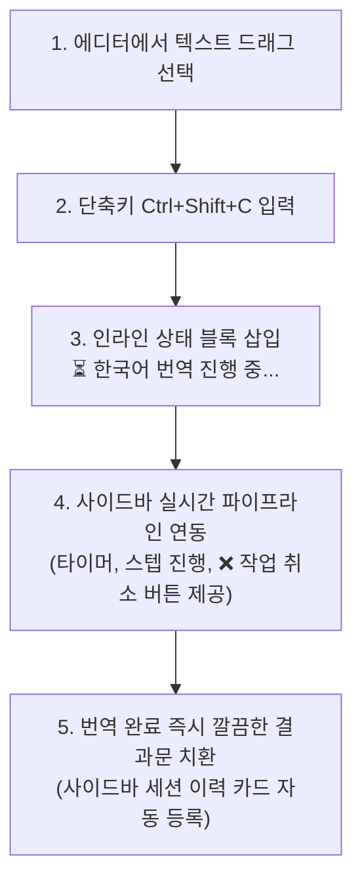

# [제3편] 스마트 마크다운 번역 & 단축키 실전 활용 매뉴얼

> **Assistant Emily** 는 단순한 텍스트 번역기가 아닙니다. 내부 위키링크(`[[Note]]`), 태그, LaTeX 수식, 코드 블록을 안전하게 지켜내며, 단축키 하나로 마크다운 문서를 원하는 방식(원문 아래 덧붙이기, 단락별 1:1 대조, 전체 완역)으로 변환합니다.

---

## 📌 3대 번역 범위(Scope) 비교표

| 번역 범위 (Scope) | 동작 방식 | 권장 용도 |
| :--- | :--- | :--- |
| **선택 영역 번역 (Selection)** | 마우스/키보드로 드래그 선택한 블록만 번역하여 원문 직하단에 덧붙임 | 핵심 문단 확인, 논문 발췌문 번역, 빠른 단축키 작업 |
| ** 전체 문서 번역 (All)** | 마크다운 문서 전체(제목, 모든 문단)를 처음부터 끝까지 완전 번역 | 영문 아티클, 해외 기술 보고서 전체 번역 |
| ** 단락별 원문 대조 병기 (Paragraph Bilingual)** | 원문 문단 하나 아래에 번역문 하나를 교차 배치 (1:1 매칭) | 해외 원서 및 영문 학술 논문 정독, 대조 학습 |

---

## 1단계: DeepL 스타일 빠른 선택 번역 & 단축키 활용

가장 빠르고 빈번하게 사용되는 작업 흐름입니다.



### 1. 기본 단축키
* **Windows / Linux**: **`Ctrl + Shift + C`**
* **macOS**: **`Cmd + Shift + C`**

> [!NOTE]
> 옵시디언의 `설정 > 단축키` 메뉴에서 `선택 영역 번역 후 바로 아래에 덧붙이기` 를 검색하여 사용자가 원하는 임의의 단축키로 언제든지 자유롭게 변경할 수 있습니다.

### 2. 마우스 우클릭 컨텍스트 메뉴
마우스 중심 작업을 선호하는 경우, 에디터에서 텍스트를 선택한 후 마우스 우클릭하여 **`Assistant Emily: 선택 영역 번역 후 바로 아래에 덧붙이기`** 항목을 클릭해도 완전히 동일하게 동작합니다.

### 3. 실시간 파이프라인 동기화 및 작업 취소(`❌ 작업 취소`)
* 단축키를 누르면 우측 사이드바가 자동으로 활성화되며, 현재 몇 글자를 번역 중인지, LLM 통신 경과 시간이 몇 초인지(`0.0s`) 실시간 타이머로 보여줍니다.
* 번역 도중 다른 작업을 해야 하거나 요청을 중단하고 싶을 때는 사이드바 상단 우측의 **`❌ 작업 취소`** 버튼을 누르십시오.
* 취소 즉시 백그라운드 AI 통신이 안전하게 중단되고, 에디터에 임시로 표시되던 상태 안내문이 삭제되어 원문 텍스트가 100% 원상태로 깨끗하게 복구됩니다.

---

## 2단계: 전체 문서 번역 및 1,800자 스마트 청킹(Smart Chunking)

긴 기술 블로그나 해외 논문 전체를 번역할 때 활용합니다.

1. 우측 사이드바의 번역 스위치를 **ON** 으로 켭니다.
2. 번역 범위(Scope)에서 **[전체 완전 번역 (All)]** 아이콘 버튼을 클릭합니다.
3. 원문 보존 방식(Preservation)을 선택합니다:
   * **새 파일에 쓰기**: 원본 문서를 건드리지 않고 `_ko.md` 접미사가 붙은 새 마크다운 파일을 생성합니다.
   * **번역 후 원문 보관 (Append)**: 현재 문서의 맨 끝에 빈 줄을 두고 전체 번역본을 이어 붙입니다.
   * **원본 파일 직접 번역 (Overwrite)**: 현재 문서의 내용을 완성된 번역본으로 직접 교체합니다.
4. **[작업 시작하기]** 버튼(또는 지시창에서 `Ctrl + Enter` )을 누릅니다.

> [!TIP]
> **1,800자 스마트 청킹이란?**
> LLM은 단일 출력 토큰 한계가 있어 긴 문서를 한 번에 요청하면 뒷부분이 잘리는 치명적인 문제가 발생합니다. Assistant Emily는 문장과 문단의 의미를 해치지 않는 선에서 약 1,800자 단위로 문서를 지능적으로 분할한 뒤 순차 번역하여 결합하므로, 수만 자의 긴 문서도 누락 없이 안전하게 완역됩니다.

---

## 3단계: 단락별 원문 대조 병기 (1:1 정독 모드)

학술 연구자나 학생에게 가장 유용한 기능입니다.

1. 사이드바 번역 범위에서 **[단락별 원문 병기 (Paragraph Bilingual)]** 버튼을 선택합니다.
2. 실행하면 다음과 같이 원본 문단 바로 밑에 번역 문단이 쌍으로 배치됩니다:

```markdown
Deep learning architectures, particularly Transformers, have revolutionized natural language processing.
심층 학습 아키텍처, 특히 트랜스포머(Transformer)는 자연어 처리 분야에 혁신을 가져왔습니다.

Attention mechanisms allow models to focus on relevant parts of the input sequence dynamically.
어텐션(Attention) 메커니즘을 통해 모델은 입력 시퀀스의 관련 부분에 동적으로 집중할 수 있습니다.
```

---

## 4단계: 문체(Tone)와 번역 스타일(Style) 커스텀

문서의 목적에 따라 AI의 어조와 번역 성향을 정밀하게 제어할 수 있습니다.

### 1. 문체 (Tone)
* **학술 연구 (Academic)**: 객관적이고 엄격한 학술 어조 (`~다`, `~한다` 종결어미 사용).
* **전문 비즈니스 (Business)**: 정중하고 명확한 비즈니스 보고서 어조 (`~합니다`, `~됩니다`).
* **친근한 구어체 (Casual)**: 부드럽고 자연스러운 대화체 (`~해요`, 블로그 게시물용).

### 2. 스타일 (Style)
* **정확한 직역 (Literal)**: 원문의 단어와 문장 구조를 원형에 가깝게 1:1 대응.
* **균형 (Balanced)**: 직역의 정확성과 한국어의 자연스러움을 고르게 조화 (기본값).
* **유려한 의역 (Natural Fluency)**: 한국어 모국어 화자가 읽기 편하도록 문맥에 맞춰 매끄럽게 재구성.

### 3. 소스코드 내부 주석 번역 (`translateCodeComments`)
* 옵션을 켜면 소스코드 블록(```` ```python ... ``` ````) 내부의 변수명, 함수명, 문법 구조는 100% 보존하고 개발자 주석(`//`, `#`, `/* */`)만 한국어로 정밀 번역합니다.

---

## 5단계: 선택적 서식 제거기 (Markdown Stripper)

다른 웹사이트나 PDF에서 복사해 온 마크다운에 불필요한 서식이 과도하게 섞여 있는 경우, 번역 및 편집과 동시에 서식을 제거할 수 있습니다:
* **볼드체 제거**: `**텍스트**`, `__텍스트__` ➔ `텍스트`
* **기울임 제거**: `*텍스트*`, `_텍스트_` ➔ `텍스트`
* **취소선 제거**: `~~텍스트~~` ➔ `텍스트`
* **형광펜 제거**: `==텍스트==` ➔ `텍스트`
* *(코드 블록과 수식은 절대 건드리지 않고 보호됩니다)*

---

## 🚀 다음 단계

번역된 결과를 교열하고 시각적 대조 모달로 검토하는 방법을 알아보세요:

* ➡️ **[제4편: 전문 AI 마크다운 교열 및 실시간 대조 검토 모달 활용 매뉴얼](04-proofreading-and-diff-review.md)**
