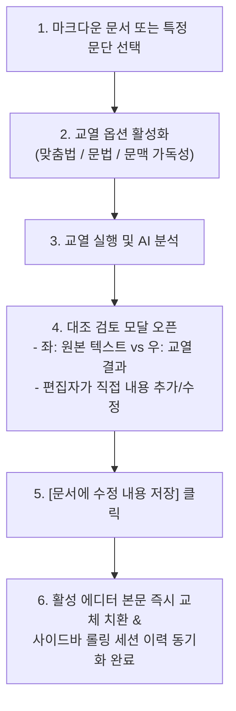

# [제4편] 전문 AI 마크다운 교열 및 실시간 대조 검토 모달 활용 매뉴얼

> 번역을 마쳤거나 직접 작성한 마크다운 문서의 품질을 한 차원 높이고 싶으신가요? **Assistant Emily** 는 맞춤법, 문법, 문맥 흐름을 정밀 교열하며, 원문과 수정문을 나란히 비교하고 수정한 내용을 에디터 화면에 즉각 실시간 반영할 수 있는 인터랙티브 대조 검토 모달을 제공합니다.

---

## 📌 교열 파이프라인 흐름도



---

## 1단계: 3대 교열 도구 활성화 및 설정

우측 사이드바의 **[마크다운 교열 & 스타일링]** 아코디언을 열면 3가지 독립 교열 도구를 자유롭게 조합할 수 있습니다:

1. ** 맞춤법 검사 (Spelling Correction)**
   * 띄어쓰기 오류, 오탈자, 표준어 규정 위반을 교정합니다.
   * 전문 기술 용어(예: Docker, Kubernetes, PyTorch)는 임의로 바꾸지 않고 고유명사로 보호합니다.
2. **문법 교정 (Grammar Refinement)**
   * 주어-서술어 호응 불일치, 불필요한 피동/이중 피동 표현, 조사 오용을 교정합니다.
3. **문맥 및 가독성 다듬기 (Contextual Flow)**
   * 문장이 지나치게 길거나 만연체인 경우 간결하고 명확한 문장으로 분리 및 윤문합니다.
   * 단락 간의 논리적 연결을 매끄럽게 보정합니다.

---

## 2단계: 교열 작업 실행 (선택 영역 vs 전체 문서)

* **특정 문단만 교열하고 싶을 때**:
  1. 에디터에서 교열할 문단을 마우스로 드래그 선택합니다.
  2. 사이드바의 지시사항 입력창(`customPrompt`)에 추가 요청사항(예: "더 정중한 어조로", "블로그 독자 친화적으로")을 기입할 수 있습니다.
  3. **[작업 시작하기]** 버튼(단축키: `Ctrl + Enter` )을 누릅니다.
* **문서 전체 교열**:
  * 선택 영역 없이 문서에 커서만 둔 상태에서 실행하면 문서 전체를 분석합니다.

---

## 3단계: 인터랙티브 대조 검토 모달 (`TranslationDiffModal` / `ProofreadDiffModal`)

작업이 완료되면 직관적인 좌우 2분할 대조 검토 창이 나타납니다.

```
┌────────────────────────────────────────────────────────────────────────┐
│ 🔍 Assistant Emily: 번역 결과 대조 검토 및 교정                           │
├──────────────────────────────────┬─────────────────────────────────────┤
│ 📄 원본 텍스트                     │ ✨ AI 번역/교열 결과 (직접 편집 가능)  │
├──────────────────────────────────┼─────────────────────────────────────┤
│ Artificial Intelligence is       │ 인공지능은 소프트웨어가             │
│ transforming how software is     │ 구축되는 방식을                     │
│ built.                           │ 변화시키고 있습니다.                │
│                                  │                                     │
│                                  │ [편집자가 여기에 추가 보완 문장을     │
│                                  │  직접 입력할 수 있습니다.]          │
├──────────────────────────────────┴─────────────────────────────────────┤
│ [취소]                   [클립보드 복사]        [문서에 수정 내용 저장] (Primary) │
└────────────────────────────────────────────────────────────────────────┘
```

### 주요 검토 기능
1. **좌우 대조 비교**: 원문(좌측)과 AI 번역/교열 결과(우측)를 한눈에 대조하여 누락된 내용이나 어색한 표현이 없는지 점검합니다.
2. ** 직접 편집 기능**: 우측 결과창은 단순 뷰어가 아닌 ** 편집 가능한 텍스트 에디터** 입니다. 번역된 문장에 추가 설명을 덧붙이거나 문맥을 직접 다듬을 수 있습니다.
3. ** 상황 인지형 프라이머리 버튼**:
   * 보존 전략이 `append` (원문 아래 덧붙이기)인 경우 ➔ **`문서에 수정 내용 저장`**
   * 보존 전략이 `overwrite` (덮어쓰기)인 경우 ➔ **`문서에 수정 내용 덮어쓰기`**
   * 보존 전략이 `new_file` 인 경우 ➔ **`새 파일로 저장`**

---

## 4단계: 문서 화면 실시간 즉각 반영 및 세션 동기화

수정 작업을 마친 뒤 **`[문서에 수정 내용 저장]`** 버튼을 클릭하면 다음과 같은 동기화 파이프라인이 즉시 가동됩니다:

1. ** 에디터 본문 실시간 즉시 치환**:
   * 플러그인이 현재 활성 마크다운 에디터 화면(버퍼)에서 기존에 삽입되었던 번역문을 정밀 탐색하여, 사용자가 직접 수정한 최신 텍스트로 즉각 치환합니다.
   * 사용자가 수동으로 복사-붙여넣기할 필요가 전혀 없습니다.
2. **사이드바 세션 이력 및 캐시 동기화**:
   * 우측 사이드바 하단의 세션 카드(`RollingSessionData`) 내부 데이터가 사용자의 수정본으로 자동 갱신됩니다.
   * 나중에 사이드바에서 **`[번역 결과 대조 검토]`** 버튼을 다시 열더라도 방금 편집했던 내용이 100% 무손실 상태로 그대로 보존되어 있습니다.

---

## 5단계: 사이드바 롤링 세션 이력 관리

사이드바 하단에는 최근 작업한 번역 및 교열 작업 카드가 시간순으로 보관됩니다.

* **텔레메트리 및 리소스 정보 확인**:
  * 사용된 모델명 (예: `qwen2.5:14b`, `gpt-4o-mini`)
  * 응답 소요 시간 (예: `2.1s`) 및 처리 속도 (`95.4 t/s`)
  * 토큰 사용량 (프롬프트 토큰, 출력 토큰, 캐시 토큰)
* **세션 삭제 및 정리**: 불필요한 작업 카드는 개별 삭제(`🗑️`)하거나 상단 버튼으로 일괄 접어둘 수 있습니다.

---

## 🚀 다음 단계

유튜브 강의 자막이나 웹 클리핑 노트를 다룰 때 발생하는 타임스탬프 뭉개짐과 레이아웃 파괴를 방지하는 방법을 알아보세요:

* ➡️ **[제5편: 유튜브 자막 및 웹 클리핑 노트 무손실 정제 매뉴얼](05-video-clipping-and-transcripts.md)**
