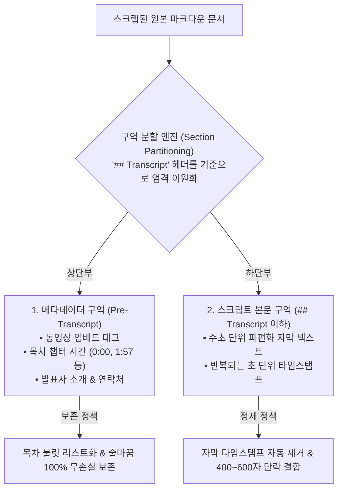

# [제5편] 유튜브 자막 및 웹 클리핑 노트 무손실 정제 매뉴얼

> 유튜브 요약 확장 프로그램(YouTube Summary with ChatGPT, Glasp 등)이나 옵시디언 공식 웹 클리퍼로 스크랩한 강의 자막은 수초 단위로 파편화되어 읽기 어렵고, 일반 번역기를 돌리면 상단 영상 링크와 목차가 뭉개지는 치명적인 문제가 발생합니다. **Assistant Emily** 가 이를 어떻게 완벽하게 구조화하고 정제하는지 안내합니다.

---

## 📌 영상 클리핑 문서의 2대 구역 분할 원리

웹 클리핑된 영상 노트는 성격이 전혀 다른 두 구역으로 이루어져 있습니다:



---

## 1단계: 상단 메타데이터 구역의 100% 무손실 보존

일반 번역기에 영상 요약 노트를 넣으면 발표자의 연락처나 이메일 목록이 한 줄로 엉겨 붙는 문제가 흔히 일어납니다. Assistant Emily는 이를 다음과 같이 원형 그대로 보호합니다:

1. **동영상 임베드 태그 보존 및 사후 확정 복원**:
   * `` 또는 `<iframe...>` 태그를 사전에 격리하며, 만약 LLM이 출력 도중 실수로 누락하더라도 플러그인이 코드 레벨에서 100% 원위치에 다시 복원합니다.
2. **강의 목차 타임스탬프의 불릿 리스트화 (`TOCTIME` 마스킹)**:
   * `0:00 Intro`, `1:57 BEGINNER`, `25:17 Summary` 같은 챕터 시간대를 불변 토큰으로 잠그고, `- 0:00 설명` 형태의 깔끔한 마크다운 리스트로 자동 서식화합니다.
3. **연락처 줄바꿈 보존**:
   * `Connect:`, `Newsletter:`, `LinkedIn:` 아래에 나열된 줄바꿈 링크들을 단 1칸의 왜곡 없이 보존합니다.

---

## 2단계: 스크립트 본문(`## Transcript`) 정제 및 문단 리플로우

하단의 자막 본문은 음성 인식 텍스트 특성상 문장이 조각조각 잘려 있습니다:

```markdown
<!-- 원본 클리핑 예시 -->
## Transcript
0:00 Artificial intelligence is rapidly evolving.
0:05 We are seeing major breakthroughs
0:09 in large language models and reasoning systems.
```

Assistant Emily로 번역을 실행하면 다음과 같이 **자막 타임스탬프는 지능적으로 제거** 되고, ** 의미 있는 문단(400~600자)으로 매끄럽게 결합** 됩니다:

```markdown
<!-- 정제 및 번역 완료 예시 -->
## Transcript
인공지능은 급격하게 발전하고 있습니다. 우리는 대형 언어 모델과 추론 시스템 전반에 걸쳐 중대한 기술적 도약을 목격하고 있습니다.
```

---

## 3단계: 유튜브 챕터별 소주제(H3) 자동 구조화

긴 강의 영상의 경우 구간별로 어떤 주제를 다루는지 목차가 분리되어 있습니다. Assistant Emily는 원문의 주제 단위를 감지하여 자막 본문 내부에도 **`### [타임스탬프] 주제명`** 형태의 독립 소제목(H3)을 자동으로 삽입하여 구조화합니다.

```markdown
## Transcript

### 0:00 개요 및 인공지능의 발전
인공지능은 현대 지식 작업의 패러다임을 근본적으로 변화시키고 있습니다...

### 1:57 트랜스포머 아키텍처의 혁신
트랜스포머 모델의 핵심인 셀프 어텐션(Self-Attention) 메커니즘은...
```

---

## 4단계: 음성 전사(STT) 숫자 연속 왜곡 자동 치유

음성 인식(STT) 자막에서 구두점(콜론, 쉼표)이 누락되어 숫자가 연달아 나오는 경우, 일반 번역기는 이를 엉뚱한 숫자로 왜곡 번역합니다:

* **왜곡 사례**:
  * 원문: `Claude 101 13 lessons` (강좌 101번, 13개 강의)
  * 잘못된 번역: `Claude 10113개 강의` ❌ *(1만 113개 강의라는 치명적 허위 정보 생성)*
* **Assistant Emily의 해결책**:
  * 사전 처리 엔진이 `101 13` 패턴을 감지하여 고유 강좌 번호와 수량 단위를 분리(`Claude 101: 13 lessons`).
  * 번역 후에도 대조 검증을 수행하여 **`Claude 101: 13개 강의`** 로 100% 자동 치유합니다.

---

## 5단계: 일반 웹 기사 및 마크다운 문서 자동 우회(Bypass)

영상 자막이 아닌 일반 인터넷 뉴스, 기술 블로그, 논문 문서를 번역할 때는 `## Transcript` 헤더나 자막 타임스탬프가 존재하지 않습니다.

* Assistant Emily는 문서 시작 시 구역 분할 조건을 엄격히 검사하여, 일반 문서인 경우 자막 정제 전처리를 **완전히 건너뛰고(Bypass)** 사용자가 작성한 원본 문단 구성을 100% 그대로 유지합니다.

---

## 🚀 다음 단계

옵시디언의 링크, 수식, 서식이 번역 중 어떻게 보호되는지 그 심층 원리를 살펴보세요:

* ➡️ **[제6편: 옵시디언 고유 문법(OFM) 무손실 마스킹 및 서식 보호 원리](06-syntax-masking-and-safety.md)**
