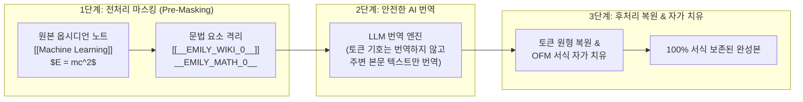

# [제6편] 옵시디언 고유 문법(OFM) 무손실 마스킹 및 서식 보호 원리

> 옵시디언(Obsidian) 환경에서 LLM을 사용할 때 가장 흔히 겪는 공포는 번역기가 소중한 내부 링크(`[[Note]]`)를 일반 영어로 오역하거나 수식 기호를 망가뜨리는 것입니다. **Assistant Emily** 가 어떻게 마크다운 문법 구조를 100% 무손실 상태로 보존하고 자가 치유하는지 안내합니다.

---

## 📌 문법 마스킹(Syntax Masking) 파이프라인 개요



---

## 1단계: 10대 핵심 문법 요소별 보호 체계

Assistant Emily의 `MarkdownMasker` 는 LLM에게 프롬프트를 전달하기 직전, 아래의 10대 핵심 요소를 감지하여 고유한 불변 토큰(`__EMILY_TOKEN_n__`)으로 일시 치환합니다:

| 보호 대상 (Syntax Target) | 예시 구문 | 마스킹 토큰 형식 | 보존 불변성 (Invariant) |
| :--- | :--- | :--- | :--- |
| **YAML 프론트매터** | `---\ntitle: Note\n---` | 본문에서 분리 격리 | 최상단 메타데이터 100% 원형 보존 |
| **코드 블록** | ```` ```python\nprint("Hello")\n``` ```` | `__EMILY_CODEBLOCK_n__` | 코드 로직, 들여쓰기, 언어 태그 완벽 보존 |
| **인라인 코드** | `` `const apiKey = 123` `` | `__EMILY_CODEINLINE_n__` | 백틱 내부 변수명 및 키워드 보존 |
| **블록 LaTeX 수식** | `$$\int_0^\infty e^{-x} dx$$` | `__EMILY_MATHBLOCK_n__` | 적분 기호, 백슬래시 이스케이프 보존 |
| **인라인 LaTeX 수식** | `$f(x) = \sigma(Wx + b)$` | `__EMILY_MATHINLINE_n__` | 인라인 수식 기호 및 수치 보존 |
| **옵시디언 위키링크** | `[[Transformer Model\|트랜스포머]]` | `[[__EMILY_WIKITARGET_n__\|별칭]]` | 대상 노트 파일명 영속 보존, 별칭만 번역 |
| **옵시디언 해시태그** | `#machine-learning/deep-learning` | `__EMILY_TAG_n__` | 태그명 번역 오염 원천 차단 |
| **콜아웃 블록** | `> [!NOTE] 제목` | `__EMILY_CALLOUT_n__` | 콜아웃 타입 및 인용문 구조 보존 |
| **이미지/영상 미디어** | `![[diagram.png]]`, `` | `__EMILY_EMBED_n__` | 볼트 내부 첨부파일 링크 및 URL 보존 |
| **목차 챕터 타임스탬프** | `1:57 BEGINNER` | `- __EMILY_TOCTIME_n__` | 타임스탬프 보존 및 불릿 리스트화 |

---

## 2단계: 옵시디언 고유 문법(OFM) 자가 치유 (Self-Healing)

번역이 완료된 후, 모델의 응답에 미세한 문법 왜곡이 발생하더라도 `MarkdownFormatter.normalizeObsidianMarkdown` 이 즉시 자가 치유를 수행합니다:

1. **헤딩 전후 개행 자동 보정**:
   * 헤딩(`#` ~ `######`) 위아래에 빈 줄이 누락되어 본문과 붙어버린 경우 자동으로 빈 줄을 삽입하여 옵시디언 개요(Outline) 인식이 깨지지 않도록 보정합니다.
2. **콜아웃 `>` 인용부호 연속성 복구**:
   * LLM이 콜아웃 내부 줄바꿈에서 `>` 접두사를 빼먹은 경우, 콜아웃 블록이 끝날 때까지 `>` 접두사를 자동으로 채워 넣습니다.
3. **유출된 HTML 태그의 마크다운 변환**:
   * 일부 모델이 출력한 `<br>`, `<b>`, `<i>`, `<mark>` 등의 불필요한 HTML 태그를 순수 마크다운 및 옵시디언 하이라이트(`==형광펜==`)로 표준화합니다.

---

## 3단계: 교차 언어 누출(중국어 간체) 및 미번역 영어 자동 차단

다국어 오픈소스 모델(DeepSeek, Qwen 등)을 사용할 때 간혹 발생하는 언어 간섭 현상을 철저히 차단합니다:

1. **중국어 간체 자동 정제**:
   * 잠재 공간 간섭으로 한국어 문장 사이에 `我们所拥有的`, `由于` 같은 중국어 어휘가 유출되면, 코드 레벨에서 즉각 감지하여 `우리가 가진 것` 등 자연스러운 한국어로 자동 변환합니다.
2. **한글 비율 분석 및 미번역 영어 재시도**:
   * 번역 수신 즉시 텍스트 블록의 라틴 문자 비율을 검사하여, 200자 이상의 문단이 번역되지 않고 영어 원문 그대로 남아있는 경우 1회 자동 자가 치유 재시도를 수행합니다.

---

## 4단계: 데이터 프라이버시 및 제로 텔레메트리(Zero Telemetry)

* **외부 수집기 제로**: Assistant Emily는 구글 애널리틱스, 센트리(Sentry), 믹스패널 등 그 어떤 외부 추적기나 사용자 행동 수집 코드를 포함하지 않습니다.
* **직접 연결 원칙**: 사용자가 설정한 로컬 Ollama 또는 상용 API 엔드포인트와 옵시디언 데스크톱 앱 간에 오직 1:1 직접 통신만 수행합니다.

---

## 🚀 다음 단계

플러그인 사용 중 발생할 수 있는 오류나 궁금증을 해결하는 방법을 살펴보세요:

* ➡️ **[제7편: 장애 진단 및 문제 해결 가이드 (Troubleshooting & FAQ)](07-troubleshooting.md)**
