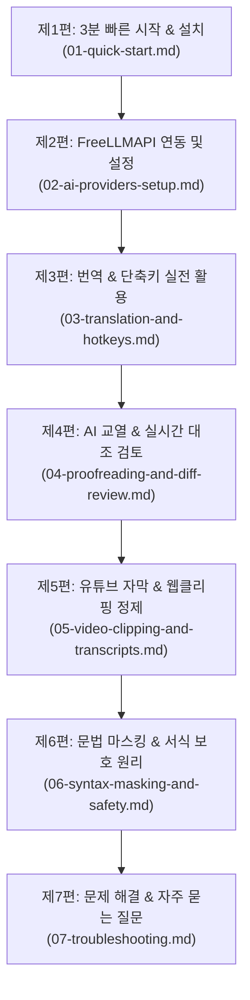

# Assistant Emily 공식 사용자 매뉴얼 (Documentation Hub)

> **Assistant Emily** 는 옵시디언(Obsidian) 환경에서 내부 위키링크(`[[Note]]`), LaTeX 수식(`$...$`), 콜아웃, 코드 블록 등 마크다운 고유 서식을 100% 무손실 보존하며 스마트 번역 및 AI 교열을 제공하는 전문 데스크톱 플러그인입니다.

본 문서 보관소(`/docs`)는 처음 시작하는 사용자부터 파워 유저까지 단계별로 쉽게 따라하며 모든 핵심 기능을 완전히 마스터할 수 있도록 체계적으로 구성된 공식 사용자 매뉴얼입니다.

> 🌐 **온라인 위키**: 본 매뉴얼은 [Assistant Emily GitHub Wiki](https://github.com/sparklings/emily/wiki)에서도 동일하게 제공되며 편리한 사이드바 내비게이션으로 열람하실 수 있습니다.

---

## 📚 매뉴얼 전체 목차 (Table of Contents)

다음 순서에 따라 단계별로 매뉴얼을 읽고 적용하시면 5분 안에 Assistant Emily의 모든 기능을 완벽하게 활용하실 수 있습니다.

---

### [제1편: 3분 빠른 시작 & 플러그인 설치 가이드](01-quick-start.md)
* **대상**: Assistant Emily를 처음 설치하고 즉시 사용해보고자 하는 사용자
* **핵심 내용**:
  * [옵시디언 공식 커뮤니티 플러그인 디렉터리](https://community.obsidian.md/plugins/assistant-emily) 검색 및 1클릭 설치
  * FreeLLMAPI 1분 연결 및 연결 테스트
  * 에디터 컨텍스트 메뉴 및 단축키로 선택 영역 즉시 번역 실습
  * 우측 사이드바 활성화 및 실시간 진행 상태 제어 요령

### [제2편: FreeLLMAPI 연동 및 기기별 프로필 설정 매뉴얼](02-ai-providers-setup.md)
* **대상**: FreeLLMAPI를 연결하고 멀티 디바이스 환경을 구축하려는 사용자
* **핵심 내용**:
  * FreeLLMAPI(34개 이상 무료 LLM 통합 프록시) 전용 연결 가이드
  * 무제한 제로 비용 모델 선택 및 연결 헬스 체크
  * Obsidian Sync / 클라우드 볼트 동기화 시 설정 충돌을 방지하는 **기기 프로필(Device Profile)** 운용법

### [제3편: 스마트 마크다운 번역 & 단축키 실전 활용 매뉴얼](03-translation-and-hotkeys.md)
* **대상**: 문서 번역, 단락별 1:1 대조 번역, 빠른 텍스트 번역이 필요한 사용자
* **핵심 내용**:
  * 선택 영역 번역 & 원문 아래 덧붙이기(단축키 지정 및 우클릭 메뉴 활용)
  * 전체 문서 번역 및 1,800자 스마트 청킹(Smart Chunking) 자동 분할 완역
  * 단락별 원문 대조 병기(Paragraph Bilingual) 모드로 외국어 논문 정독하기
  * 문체(학술 연구, 비즈니스, 캐주얼) 및 직역/의역 밸런스 설정
  * 선택적 서식 제거기(볼드, 이탤릭, 취소선, 형광펜) 활용
  * 사이드바 실시간 파이프라인 진행 상태 및 `❌ 작업 취소` 기능

### [제4편: 전문 AI 마크다운 교열 및 실시간 대조 검토 모달 활용 매뉴얼](04-proofreading-and-diff-review.md)
* **대상**: 블로그 글, 기술 보고서, 논문 마크다운의 맞춤법과 문맥을 다듬고자 하는 사용자
* **핵심 내용**:
  * 맞춤법, 문법 교정, 문맥/가독성 개선 3대 교열 도구 활용
  * 대조 검토 모달(`TranslationDiffModal` / `ProofreadDiffModal`) 인터랙티브 UI
  * 편집창에서 직접 수정한 내용을 활성 에디터 본문에 실시간 즉각 치환하는 방법
  * 사이드바 롤링 세션 이력 관리 및 작업 이력 추적

### [제5편: 유튜브 자막 및 웹 클리핑 노트 무손실 정제 매뉴얼](05-video-clipping-and-transcripts.md)
* **대상**: YouTube Summary, Glasp, 웹 클리퍼로 스크랩한 긴 강의 자막을 읽기 쉽게 정리하려는 사용자
* **핵심 내용**:
  * 메타데이터 구역(영상 링크, 목차 타임스탬프, 연락처) 100% 무손실 보존
  * 스크립트 본문 구역(`## Transcript`) 타임스탬프 자동 제거 및 매끄러운 문단 리플로우
  * 영상 챕터별 소주제(H3) 자동 구조화
  * 음성 전사(STT) 숫자 연속(예: `101 13 lessons` ➔ `101: 13개 강의`) 자동 치유

### [제6편: 옵시디언 고유 문법(OFM) 무손실 마스킹 및 서식 보호 원리](06-syntax-masking-and-safety.md)
* **대상**: 옵시디언 지식 베이스의 링크와 수식이 어떻게 완벽하게 보호되는지 궁금한 엔지니어 및 사용자
* **핵심 내용**:
  * 10대 핵심 문법 요소 UUID 기반 불변 토큰(`__EMILY_TOKEN_n__`) 격리 구조
  * 목차 타임스탬프(`TOCTIME`) 불릿 리스트 고정 메커니즘
  * OFM 자가 치유(헤딩 줄바꿈 복원, 콜아웃 `>` 인용부호 보정, HTML 정규화)
  * 다국어 LLM의 중국어 간체 누출 방지 및 미번역 영어 자동 재시도
  * 데이터 프라이버시 및 제로 텔레메트리 원칙

### [제7편: 장애 진단 및 문제 해결 가이드 (Troubleshooting & FAQ)](07-troubleshooting.md)
* **대상**: 통신 오류, 컨텍스트 한도 초과, 단축키 충돌 등 이상 현상을 해결하려는 사용자
* **핵심 내용**:
  * 주요 증상별 빠른 해결 매트릭스 표
  * 502 Bad Gateway / Connection Refused 진단 및 복구
  * 413 Payload Too Large / 컨텍스트 초과 대처 요령
  * 단축키 변경 및 옵시디언 기본 단축키 시스템과의 충돌 해소
  * 자주 묻는 질문(FAQ) 모음

---

## 🔬 심층 기술 가이드 (Technical Guides)

* ### [FreeLLMAPI 아키텍처 및 연동 기술 가이드](freellmapi-technical-guide.md)
  * **핵심 내용**: 34개 무료 프로바이더, 635개 엔드포인트의 통합 연동 분석 및 고가용성 장애 극복 설계
* ### [OFM 무손실 문법 마스킹 파이프라인 엔지니어링 가이드](markdown-syntax-masking-pipeline-technical-guide.md)
  * **핵심 내용**: 정규식 기반 UUID 토큰 치환, 토큰 텍사노미, LLM 자율 복구 정규화 엔진의 내부 아키텍처

---

## 💡 지원 및 커뮤니티

* **GitHub 저장소**: [https://github.com/sparklings/emily](https://github.com/sparklings/emily)
* **버그 제보 및 기능 제안**: [GitHub Issues](https://github.com/sparklings/emily/issues)
* **라이선스**: MIT License
