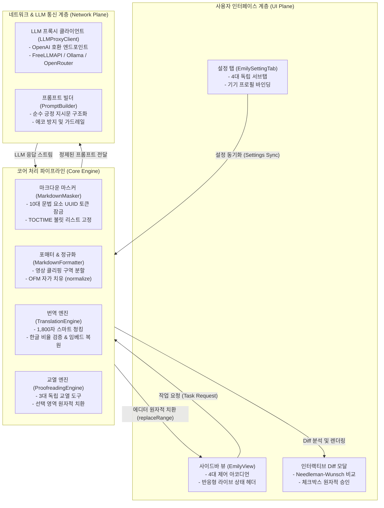
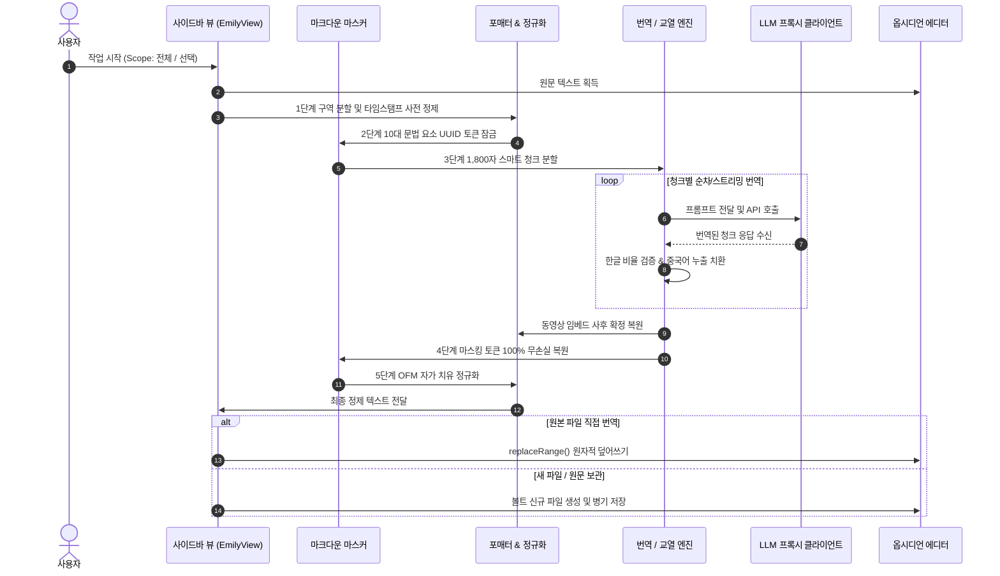

# Assistant Emily: 시스템 아키텍처 및 코어 설계 명세서
### System Architecture & Pipeline Specification

본 문서는 **Assistant Emily** (이하 `assistant-emily`)의 내부 아키텍처, 컴포넌트 간 상호작용, 데이터 흐름, 그리고 옵시디언(Obsidian) 데스크톱 샌드박스 환경 내에서의 무손실 마크다운 처리 파이프라인 설계를 기술합니다.

---

## 1. 개요 및 공학적 목표 (Overview & Objectives)

옵시디언과 같은 로컬 마크다운 지식 베이스 환경에서 대형 언어 모델(LLM)을 활용할 때 가장 빈번하게 발생하는 문제는 **마크다운 추상 구문 트리(AST) 및 옵시디언 고유 문법의 훼손** 입니다.

일반적인 웹 기반 AI 도구나 단순 텍스트 프롬프트는 다음과 같은 결함을 유발합니다:
1. **옵시디언 위키링크 및 태그 파괴**: `[[Note]]`를 일반 텍스트나 영문으로 오역하거나 태그(`#tag`)를 헤딩으로 오인.
2. **수식 및 코드 블록 서식 왜곡**: LaTeX 블록(`$$...$$`)의 백슬래시 이스케이프 유실, 코드 블록 내부 문법 변조.
3. **타임스탬프 및 메타데이터 붕괴**: 영상 클리핑 노트의 목차 타임스탬프(`1:57 BEGINNER`)나 연락처 줄바꿈이 한 줄로 뭉개짐.
4. **대용량 문서 컨텍스트 초과**: LLM의 단일 출력 토큰 한계(4,096 토큰)로 인한 문서 뒷부분 절단.

**Assistant Emily** 는 이러한 문제를 극복하기 위해 **독자적인 문법 마스킹 파이프라인(Syntax Masking Pipeline)** 과 **구역 분할 정제 엔진(Section Partitioning Engine)** 을 기반으로 설계되었습니다.

---

## 2. 전체 시스템 아키텍처 (System Architecture)

Assistant Emily는 단일 거대 모듈이 아닌, 단일 책임 원칙(SRP)에 따라 엄격하게 분리된 6개의 핵심 서브시스템으로 구성됩니다.

---

## 3. 핵심 서브시스템별 상세 명세

### 3.1 마크다운 마스커 (`MarkdownMasker`)
* **역할**: LLM에 전달하기 전, 보호해야 할 마크다운 문법 요소를 안전한 UUID 형태의 토큰(`__EMILY_TOKEN_n__`)으로 치환하고 번역 완료 후 100% 무손실 복원합니다.
* **주요 보호 대상**:
  * YAML 프론트매터 (`--- ... ---`)
  * 옵시디언 위키링크 (`[[Note]]`, `[[Note|Alias]]`)
  * 옵시디언 해시태그 (`#tag`, `#parent/child`)
  * LaTeX 수식 (`$...$`, `$$...$$`)
  * 콜아웃 헤더 (`> [!NOTE]`, `> [!WARNING]`)
  * 코드 블록 (\`\`\`...\`\`\`) 및 인라인 코드 (\`...\`)
  * 체크리스트 태스크 (`- [ ]`, `- [x]`), 옵시디언 하이라이트 (`==text==`), 비공개 주석 (`%%...%%`)
  * 블록 식별자 (`^block-id`), 각주 정의 (`[^1]:`)
  * 목차 챕터 타임스탬프 (`__EMILY_TOCTIME_n__`)

### 3.2 포매터 및 정규화 엔진 (`MarkdownFormatter`)
* **역할**: 마크다운 서식 정제 및 옵시디언 마크다운(OFM) 표준 렌더링 자가 치유를 담당합니다.
* **구역 분할 정제 (Section Partitioning)**:
  * 일반 기사/웹 문서는 원형을 100% 보존합니다.
  * 유튜브 클리핑 문서는 `## Transcript` 이전 메타데이터(동영상 링크, 목차, `Connect:`) 구역의 줄바꿈을 원형 보존하고, `## Transcript` 이하 본문만 타임스탬프를 제거하여 400~600자 단위 유려한 단락으로 결합합니다.
* **OFM 자가 치유 (`normalizeObsidianMarkdown`)**:
  * 헤딩(`#`–`######`) 전후 빈 줄 자동 삽입으로 단락 융합 방지.
  * 콜아웃 블록 내부의 누락된 `>` 인용 부호 연속성 자동 복원.
  * LLM이 출력한 잔여 인라인 HTML 태그(` `, `<b>`, `<strong>`, `<i>`, `<em>`, `<mark>`)를 표준 마크다운 및 `==하이라이트==`로 자동 변환.

### 3.3 번역 엔진 (`TranslationEngine`)
* **스마트 청킹 (Smart Chunking)**: 1,800자 단위로 헤딩 계층과 문단 경계를 분석하여 무결성을 유지하며 분할 번역 후 결합.
* **미번역 영어 누출 방지**: 200자 이상의 미번역 영어 덩어리(라틴 문자 75% 이상)를 감지하여 자동 자가 치유 재시도.
* **중국어 간체 유출 정제**: 다국어 모델의 교차 언어 누출 어휘(`我们所拥有的` 등)를 순수 한국어로 자동 치환.
* **동영상 임베드 확정 복원 (`ensureVideoEmbedsPreserved`)**: LLM이 영상 태그를 누락하더라도 코드 레벨에서 상단에 확정 재주입.

### 3.4 LLM 프록시 클라이언트 (`LLMProxyClient`)
* **통신 프로토콜**: OpenAI Chat Completions API 규격을 준수하며, `FreeLLMAPI`, 로컬 Ollama (`/v1`), LM Studio, vLLM, OpenRouter 엔드포인트를 폭넓게 지원합니다.
* **통신 장애 대응**: 502 Bad Gateway 또는 네트워크 미도달 시 상단 팝업 Notice를 억제하고 사이드바 타임라인 Step 2에 친절한 진단 안내를 렌더링합니다.

---

## 4. 데이터 흐름 및 상태 전이 (Data Flow)

---

## 5. 저장소 동기화 및 기기 프로필 격리 (Device Profile Isolation)

OneDrive, iCloud, Obsidian Sync 등 클라우드 볼트 동기화를 사용하는 환경에서 사용자가 여러 기기(예: 사무실 PC, 자택 노트북)를 오갈 때 API 엔드포인트나 모델 설정이 충돌하는 문제를 방지하기 위해 **기기 고유 식별자(Device UUID) 기반 설정 바인딩** 구조를 채택했습니다.

| 계층 | 영속화 위치 | 격리 여부 | 주요 저장 항목 |
| :--- | :--- | :--- | :--- |
| **전역 설정 (Global)** | `data.json` 루트 | 동기화 공유 | UI 언어, 기본 번역 문체, 서식 정규화 옵션 |
| **기기 프로필 (Device Profiles)** | `data.json -> profiles[deviceId]` | **기기별 독립 격리** | 활성 AI 엔드포인트 URL, 모델 식별자, 로컬 Ollama 포트, API 키 |

각 기기는 구동 시 로컬 머신의 고유 해시를 계산하여 해당 기기에 할당된 프로바이더 구성을 자동 로드하므로, 사무실에서는 원격 프록시를 사용하고 노트북에서는 로컬 Ollama를 사용하는 구성이 충돌 없이 공존할 수 있습니다.
