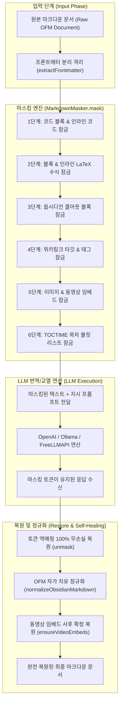

# Lossless Markdown Syntax Masking Pipeline Technical Guide

> 🧭 **위키 내비게이션**: [🏠 위키 홈](README.md) · [제1편: 빠른 시작](01-quick-start.md) · [제2편: 연동 설정](02-ai-providers-setup.md) · [제3편: 번역 & 단축키](03-translation-and-hotkeys.md) · [제4편: AI 교열 & 대조](04-proofreading-and-diff-review.md) · [제5편: 유튜브 자막](05-video-clipping-and-transcripts.md) · [제6편: 문법 보호](06-syntax-masking-and-safety.md) · [제7편: FAQ & 해결](07-troubleshooting.md) | [FreeLLMAPI 가이드](freellmapi-technical-guide.md) · [문법 마스킹 가이드](markdown-syntax-masking-pipeline-technical-guide.md)

### 옵시디언 마크다운 문법 무손실 마스킹 및 자가 치유 파이프라인

본 문서는 **Assistant Emily** 에서 대형 언어 모델(LLM)을 활용하여 번역, 교열, 서식 정합을 수행할 때, 옵시디언 고유 문법(Obsidian Flavored Markdown, OFM), LaTeX 수식, 위키링크, 코드 블록, 그리고 영상 목차 타임스탬프를 100% 무손실로 보존하기 위해 채택한 **클라이언트 사이드 인메모리 문법 마스킹 파이프라인(Syntax Masking Pipeline)** 의 내부 메커니즘과 공학적 설계 명세를 기술합니다.

---

## 1. Overview & Engineering Objectives

전통적인 AI 번역 및 교열 도구(ChatGPT 웹, DeepL, 일반 프롬프트 기반 플러그인)를 옵시디언 환경에 적용할 때 직면하는 가장 고질적인 문제는 **"마크다운 구문 트리(AST)의 임의적 파괴(Syntactic Destructuring at Rest)"** 입니다.

일반적인 LLM에 마크다운 문서를 직접 전달할 경우 다음과 같은 심각한 서식 왜곡이 발생합니다:
1. **옵시디언 위키링크 및 태그 변조**: `[[Machine Learning|기계학습]]`의 타깃 노트명을 `[[기계학습|기계학습]]`으로 번역하여 볼트 내부 링크를 영구 단절시키거나, 태그(`#ai/deep-learning`)의 슬래시 계층을 파괴.
2. **LaTeX 수식 및 백슬래시 이스케이프 유실**: 수식 기호(`\sum_{i=1}^n x_i`)를 텍스트로 오역하거나 이스케이프 문자(`\`)를 삭제하여 수식 렌더링 에러 유발.
3. **콜아웃 및 체크리스트 문법 해체**: `> [!NOTE]`를 번역하거나 `>` 인용 부호를 누락하여 콜아웃 블록이 일반 문단으로 붕괴.
4. **목차 타임스탬프 결합 왜곡**: `0:00 Intro`, `1:57 BEGINNER`와 같은 챕터 목차가 LLM에 의해 임의로 삭제되거나 단일 문장으로 뭉개지는 현상.

**Assistant Emily** 는 프롬프트에 의존하는 방식의 한계를 극복하고, 클라이언트 사이드에서 **"선제적 UUID 토큰 격리(Pre-emptive Token Isolation)"** 와 **"사후 완전 복원(Post-unmasking Restoration)"**, 그리고 **"OFM 자가 치유(Autonomous Self-Healing)"** 를 결합한 3단계 무손실 보존 파이프라인을 구축했습니다.

---

## 2. Syntax Masking Pipeline Architecture

문법 마스킹 파이프라인은 LLM 호출 직전 메모리 내에서 실행되며, 원본 문서를 마스킹된 텍스트(`maskedText`)와 복원용 해시 테이블(`maskMap`)로 분리합니다.



---

## 3. 마스킹 토큰 체계 및 정규식 규격 (Token Classification Specification)

Assistant Emily는 10대 핵심 문법 요소에 대해 충돌 가능성이 0%인 고유 토큰 명명 체계(`__EMILY_{TYPE}_{INDEX}__`)를 적용합니다:

| 마스킹 대상 (Target) | 정규식 패턴 (Matching Regex) | 치환 토큰 예시 | 불변성 보장 명세 (Invariant Guarantee) |
| :--- | :--- | :--- | :--- |
| **코드 블록** | ```` ```[\s\S]*?``` ```` | `__EMILY_CODEBLOCK_0__` | 프로그래밍 언어 식별자 및 코드 구문 원형 보존 |
| **인라인 코드** | `` `[^`\n]+` `` | `__EMILY_CODEINLINE_0__` | 변수명, 파일 경로, CLI 명령어 보존 |
| **블록 LaTeX** | `\$\$[\s\S]*?\$\$` | `__EMILY_MATHBLOCK_0__` | 수식 블록 내부 백슬래시 및 행렬 수식 보존 |
| **인라인 LaTeX** | `(?<!\$)\$(?!\$)((?:\\.\|[^$\\\n])+?)\$(?!\$)` | `__EMILY_MATHINLINE_0__` | 인라인 변수 수식 보존 |
| **콜아웃 블록** | `^>[ \t]*\[!([a-zA-Z0-9_-]+)\][^\n]*\n(?:>[^\n]*\n?)*` | `__EMILY_CALLOUT_0__` | 콜아웃 유형(`[!NOTE]` 등) 및 접두사 보존 |
| **위키링크 타깃** | `\[\[([^\]\|\n]+)(?:\|([^\]\n]+))?\]\]` | `[[__EMILY_WIKITARGET_0__\|별칭]]` | 대상 노트 파일명은 잠그고 별칭만 번역 허용 |
| **옵시디언 태그** | `(?<=^\|\s)#([a-zA-Z가-힣0-9_-]+(?:\/[a-zA-Z가-힣0-9_-]+)*)` | `__EMILY_TAG_0__` | 계층형 태그 및 한글/영문 태그 보존 |
| **미디어 임베드** | `!\[([^\]\n]*)\]\(([^)\n]+)\)` | `__EMILY_EMBEDIMG_0__` | 이미지 URL, 유튜브 동영상 임베드 태그 보존 |
| **볼트 내부 첨부** | `!\[\[[^\]\n]+?\]\]` | `__EMILY_EMBED_0__` | 볼트 내부 PDF, 오디오, 이미지 임베드 보존 |
| **목차 타임스탬프** | `^(\s*[-*+]?\s*)(\d{1,2}:\d{2}(?::\d{2})?)(?=\s)` | `- __EMILY_TOCTIME_0__` | 목차 시간 보존 및 개별 불릿 리스트 강제 |

---

## 4. 목차 챕터 타임스탬프 마스킹 잠금 (`TOCTIME`) 메커니즘

### 4.1 타임스탬프 왜곡 메커니즘 분석
유튜브 클리핑 문서의 목차 구역(예: `Timestamps:`)에서 다음과 같은 줄이 연속될 때:
```text
0:00 What is Gemini Notebook
1:57 BEGINNER
2:07 Sources
```
이 텍스트를 그대로 LLM에 전송하면, CommonMark 파서와 언어 모델은 각 줄 사이에 빈 줄(`\n\n`)이 없다는 이유로 이를 **단일 문단(Single Paragraph)** 으로 인식합니다. 그 결과 타임스탬프를 지우면서 다음과 같이 한 줄로 압축해버리는 치명적 결함이 발생합니다:
```text
- 초보자 - 소스 - 채팅... (목차 구조 완전 붕괴)
```

### 4.2 공학적 해결: TOCTIME 리스트 잠금
`MarkdownMasker`는 라인 시작 위치의 시간 형식을 감지하여 `- __EMILY_TOCTIME_n__`으로 치환합니다:
```typescript
target = target.replace(/^(\s*[-*+]?\s*)(\d{1,2}:\d{2}(?::\d{2})?)(?=\s)/gm, (match, prefix, timeStr) => {
  const token = getPlaceholder('TOCTIME');
  maskMap.set(token, timeStr);
  const listPrefix = prefix.trim() ? prefix : '- ';
  return `${listPrefix}${token}`;
});
```

* **효과 1 (리스트 강제)**: 접두사 `- `가 붙음으로써 LLM은 각 행을 마크다운 순서 없는 목록(`List Item`)으로 엄격히 인지하여 결합을 중단합니다.
* **효과 2 (시간 보존)**: `1:57`이라는 시간이 토큰으로 감싸여 있으므로 모델이 이를 지우거나 계산하지 못합니다.
* **효과 3 (무손실 복원)**: 번역 후 `- 1:57 초보자` 형태로 100% 온전하게 복원됩니다.

---

## 5. 자가 치유 정규화 엔진 (`normalizeObsidianMarkdown`)

마스킹 복원 직후 실행되는 `normalizeObsidianMarkdown`은 옵시디언 렌더러와의 완벽한 시각적 호환성을 위해 4대 자가 치유를 수행합니다:

1. **헤딩 개행 보정**: 모든 헤딩(`#` ~ `######`)의 상단과 하단에 `\n\n` 빈 줄을 자동 삽입하여 인접 문단과의 렌더링 융합을 방지합니다.
2. **콜아웃 연속성 보원**: 둘째 줄 이상에서 누락된 `>` 인용 부호를 자동으로 복원하여 콜아웃 박스를 닫히지 않게 유지합니다.
3. **HTML 인라인 트랜스파일링**: 모델이 임의로 생성한 `<br>`을 `\n`으로, `<b>`/`<strong>`을 `**볼드** `로, `<mark>`를 옵시디언 형광펜 `==하이라이트==`로 자동 변환합니다.
4. **체크리스트 공백 정규화**: `-[]` 및 `-[ ]` 서식을 표준 `- [ ] `로 자동 정합화합니다.

---

## 6. 테스트 스위트 및 불변성 검증 (Verification Suite)

Assistant Emily의 문법 마스킹 파이프라인은 `tests/integration_test.mjs`의 전용 테스트 케이스를 통해 엄격히 검증됩니다:

* **[TC-59] OFM 전용 문법 마스킹 & 100% 무손실 복원 검증**: 태스크, 주석, 하이라이트, 블록 ID, 각주가 포함된 복합 문서의 1:1 복원 무결성 확인.
* **[TC-60] 옵시디언 마크다운 정규화 엔진 자가 치유 검증**: 인라인 HTML 변환, 헤딩 개행 보정, 콜아웃 인용 부호 복원 검증.
* **[TC-63] 이미지 및 동영상 임베드 100% 무손실 마스킹 및 복원 검증**: 마크다운 이미지 및 위키 미디어 태그 무손실 복원 검증.
* **[TC-66] 영역 분할 기반 동영상 링크, 목차 타임스탬프, 메타데이터 줄바꿈 100% 보존 검증**: 목차가 한 줄로 뭉개지지 않고 `- 1:57 초보자`로 보존되는지 검증.

---

## 🧭 위키 내비게이션
| 이전 단계 | 현재 페이지 | 위키 홈 |
| :---: | :---: | :---: |
| [◀ FreeLLMAPI 아키텍처 가이드](freellmapi-technical-guide.md) | **OFM 무손실 문법 마스킹 파이프라인** | [🏠 위키 대문 (README.md)](README.md) |
