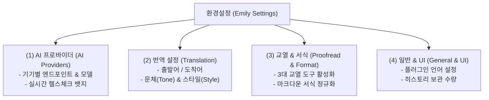

# Device Profiles & Provider Endpoint Configuration Manual
### 기기 프로필 기반 AI 엔드포인트 및 설정 매뉴얼

본 문서는 **Assistant Emily** 에서 로컬 LLM(Ollama, LM Studio), 무료 프록시(FreeLLMAPI), 클라우드 API(OpenAI, OpenRouter)를 연결하고 다중 기기 환경에서 설정 충돌 없이 최적화된 AI 페어 어시스턴트를 운용하기 위한 종합 설정 매뉴얼입니다.

---

## 1. 설정 구조 개요 (4대 독립 서브탭)

Assistant Emily의 환경설정 화면(`EmilySettingTab`)은 옵시디언 1.7.2+ 및 커뮤니티 플러그인 표준 UX 가이드라인에 맞추어 4개의 독립 탭으로 세분화되어 있습니다:



---

## 2. 기기 프로필(Device Profile) 기반 스마트 바인딩

### 2.1 문제 정의: 클라우드 볼트 동기화 시 설정 충돌
OneDrive, Google Drive, iCloud, 또는 Obsidian Sync를 통해 여러 기기(예: 사무실 데스크톱과 노트북)가 동일한 볼트를 공유할 때, 플러그인 설정 파일(`data.json`)이 동기화되면서 심각한 충돌이 발생합니다:
* 사무실 데스크톱: 로컬 고성능 GPU Ollama (`http://localhost:11434`, 모델: `qwen2.5:32b`)
* 외부 노트북: API 프록시 (`https://api.freellmapi.com/v1`, 모델: `dots-3-note-preview:free`)
* 동기화가 발생하면 노트북에서 데스크톱의 `localhost`를 호출하여 연결 실패(ECONNREFUSED)가 발생함.

### 2.2 해결책: 기기 식별자 바인딩 메커니즘
Assistant Emily는 각 기기마다 고유한 기기 ID(`deviceId`)를 생성하고, `data.json`의 `deviceProfiles` 맵에 기기별 설정을 독립 격리합니다.

```json
{
  "activeProfileId": "desktop-rtx4090",
  "deviceProfiles": {
    "desktop-rtx4090": {
      "provider": "ollama",
      "baseUrl": "http://127.0.0.1:11434/v1",
      "model": "qwen2.5:32b",
      "apiKey": ""
    },
    "laptop-macbook": {
      "provider": "freellmapi",
      "baseUrl": "https://api.freellmapi.com/v1",
      "model": "dots-3-note-preview:free",
      "apiKey": "flm_live_..."
    }
  }
}
```

볼트 파일이 동기화되더라도 각 머신은 자신의 `deviceId`에 매핑된 프로필을 읽어오므로, 장소나 네트워크 환경에 관계없이 안정적으로 구동됩니다.

---

## 3. 지원 AI 엔드포인트 연동 가이드

Assistant Emily는 OpenAI Chat Completions 규격을 지원하는 모든 백엔드와 100% 호환됩니다.

| AI 백엔드 | 기본 엔드포인트 URL | 추천 모델 | API 키 필요 여부 |
| :--- | :--- | :--- | :--- |
| **Ollama (로컬)** | `http://127.0.0.1:11434/v1` | `qwen2.5:14b`, `llama3.2:3b` | 불필요 (임의 문자열) |
| **LM Studio (로컬)** | `http://127.0.0.1:1234/v1` | 로컬 로드된 모델 식별자 | 불필요 |
| **FreeLLMAPI** | `https://api.freellmapi.com/v1` | `dots-3-note-preview:free` | 필요 (`flm_live_...`) |
| **OpenRouter** | `https://openrouter.ai/api/v1` | `deepseek/deepseek-chat` | 필요 (`sk-or-...`) |
| **OpenAI 공식** | `https://api.openai.com/v1` | `gpt-4o-mini`, `gpt-4o` | 필요 (`sk-...`) |

> [!TIP]
> 엔드포인트 URL 입력 후 [연결 테스트] 버튼을 누르면 실시간 헬스체크가 수행되어 녹색 `온라인 (Online)` 또는 적색 `오프라인 (Offline)` 뱃지가 표시됩니다.

---

## 4. 번역 및 교열 세부 옵션 규격

### 4.1 3대 작업 범위 (Scope)
* **전체 문서 번역 (`all`)**: 기본값. 문서 전체의 H1~H6 헤더와 본문을 대상 언어로 완역.
* **선택 영역 번역 (`selection`)**: 에디터에서 드래그하여 블록 지정한 텍스트만 원자적으로 번역 및 치환 (`replaceRange`).
* **단락별 1:1 대조 (`paragraph_bilingual`)**: 원문 문단 바로 아래에 번역 문단을 나란히 배치하여 학술 논문 및 외신 분석 시 최고의 가독성 제공.

### 4.2 일원화된 문체(Tone) 및 스타일(Style)
* **문체 (Tone)**:
  * `학술체 (Academic)`: `~이다/한다` 종결어미. 논문, 기술 리포트, 백서에 적합.
  * `경어체 (Polite)`: `~합니다/하십시오` 종결어미. 비즈니스 이메일, 공식 문서에 적합.
  * `친근체 (Friendly)`: `~해요/있어요` 종결어미. 블로그, 개인 노트에 적합.
* **스타일 (Style)**:
  * `직역 중심 (Literal)`: 원문의 문장 구조와 단어를 1:1로 엄밀히 대응.
  * `균형 잡힌 정제 (Balanced)`: 기본값. 의미 왜곡 없이 자연스러운 현대 한국어로 다듬기.
  * `자연스러운 의역 (Free Natural)`: 문맥 중심의 유려한 어조로 가독성 극대화.

### 4.3 3대 독립 교열 도구 (Proofreading Tools)
사이드바의 세그먼트 버튼을 통해 필요한 검사만 자유롭게 켜고 끌 수 있습니다:
1. **맞춤법 검사**: 한글 맞춤법 규정 및 표준어 규정에 따른 오탈자 수정.
2. **문법 검사**: 주술 호응 관계, 불필요한 피동/사동 표현, 어색한 조사 교정.
3. **타임스탬프 삭제**: 본문 자막에 남아 있는 불필요한 시간 기호 선제적 제거.
