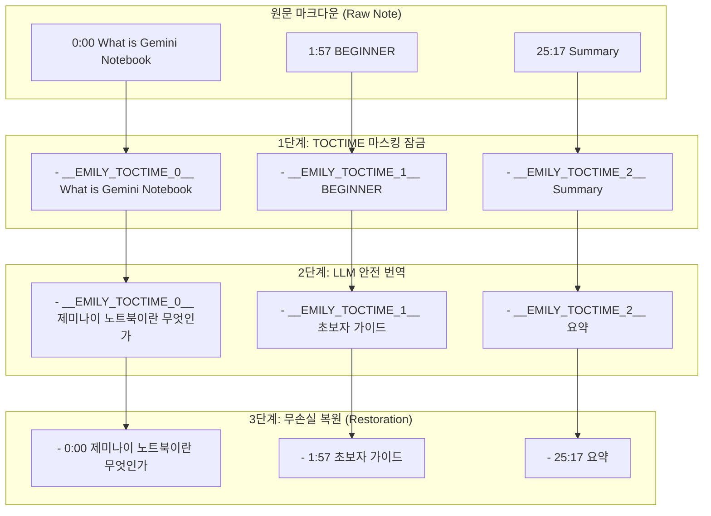

# Lossless Markdown & OFM Syntax Masking Pipeline Technical Guide
### 옵시디언 마크다운 문법 무손실 마스킹 및 자가 치유 파이프라인

본 문서는 **Assistant Emily** 에서 대형 언어 모델(LLM)을 거치면서도 옵시디언 고유 문법(OFM, Obsidian Flavored Markdown), 수식, 코드, 링크, 목차 타임스탬프를 100% 무손실로 보존하기 위해 설계된 **문법 마스킹 파이프라인(Syntax Masking Pipeline)** 의 수학적·정규식적 설계 명세를 기술합니다.

---

## 1. 배경 및 해결 과제 (Background & Problem Space)

대형 언어 모델(LLM)은 텍스트 생성 시 마크다운 서식을 "언어의 일부"로 해석하여 임의로 번역하거나 변조하는 경향이 있습니다.

대표적인 파괴 현상:
* **내부 링크 오염**: `[[Artificial Intelligence|인공지능]]` ➔ `[[인공지능|인공지능]]` 또는 `[인공지능](Artificial Intelligence)`으로 파괴.
* **수식 기호 파괴**: LaTeX 인라인 수식 `$x_i \le y$` ➔ `$x_i <= y$` 또는 수식 내부 변수 오역.
* **콜아웃 문법 해체**: `> [!NOTE]` ➔ `> [!참고]` 또는 `> ` 인용 부호 누락.
* **목차 타임스탬프 결합**: `1:57 BEGINNER`, `2:07 Sources` ➔ `- 초보자 - 소스` 한 줄로 뭉개짐.

Assistant Emily는 LLM이 서식 기호를 "번역 대상 텍스트"가 아닌 **"불가변 고유 토큰(Immutable Token)"** 으로 인식하도록 텍스트 전처리(Pre-masking) 및 후처리(Post-unmasking) 아키텍처를 구축했습니다.

---

## 2. 마스킹 토큰 체계 및 정규식 분류표 (Token Taxonomy)

Assistant Emily의 `MarkdownMasker`는 10대 핵심 문법 요소를 순차적으로 스캔하여 고유한 UUID 기반 토큰으로 격리합니다.

| 분류 (Syntax Type) | 정규식 패턴 (Regex Specification) | 마스킹 토큰 형식 | 복원 불변성 (Invariant) |
| :--- | :--- | :--- | :--- |
| **YAML 프론트매터** | `^---\r?\n([\s\S]*?\r?\n)---(?:\r?\n|$)` | 본문 분리 격리 | 최상단 원형 100% 유지 |
| **코드 블록** | ```` ```[\s\S]*?``` ```` | `__EMILY_CODEBLOCK_n__` | 코드 로직·언어 식별자 보존 |
| **인라인 코드** | `` `[^`\n]+` `` | `__EMILY_CODEINLINE_n__` | 백틱 내부 식별자 보존 |
| **블록 LaTeX 수식** | `\$\$[\s\S]*?\$\$` | `__EMILY_MATHBLOCK_n__` | 수식 기호·백슬래시 보존 |
| **인라인 LaTeX 수식** | `(?<!\$)\$(?!\$)((?:\\.|[^$\\\n])+?)\$(?!\$)` | `__EMILY_MATHINLINE_n__` | 인라인 변수·연산자 보존 |
| **콜아웃 블록** | `^>[ \t]*\[!([a-zA-Z0-9_-]+)\][^\n]*\n(?:>[^\n]*\n?)*` | `__EMILY_CALLOUT_n__` | 콜아웃 타입 및 인용문 보존 |
| **옵시디언 위키링크** | `\[\[([^\]\|\n]+)(?:\|([^\]\n]+))?\]\]` | `[[__EMILY_WIKITARGET_n__\|별칭]]` | 대상 노트 파일명 영속 보존 |
| **옵시디언 해시태그** | `(?<=^\|\s)#([a-zA-Z가-힣0-9_-]+(?:\/[a-zA-Z가-힣0-9_-]+)*)` | `__EMILY_TAG_n__` | 태그명 번역 오염 원천 차단 |
| **이미지/영상 임베드** | `!\[([^\]\n]*)\]\(([^)\n]+)\)` | `__EMILY_EMBEDIMG_n__` | 이미지 URL 및 미디어 보존 |
| **위키 미디어 임베드** | `!\[\[[^\]\n]+?\]\]` | `__EMILY_EMBED_n__` | 볼트 내부 첨부파일 링크 보존 |
| **목차 챕터 타임스탬프** | `^(\s*[-*+]?\s*)(\d{1,2}:\d{2}(?::\d{2})?)(?=\s)` | `- __EMILY_TOCTIME_n__` | 타임스탬프 보존 및 불릿 리스트화 |

---

## 3. 목차 챕터 타임스탬프 마스킹 잠금 (`TOCTIME`) 메커니즘

영상 클리핑 노트에서 사용자가 가장 불편을 겪었던 "목차 타임스탬프가 삭제되거나 한 줄로 합쳐지는 현상"을 해결하기 위해, 타임스탬프 마스킹 시 **불릿 리스트 접두사(`- `) 자동 보장 규칙** 을 도입했습니다.



### 공학적 동작 원리
1. **정규식 매칭**: 라인 시작(`^`) 위치에서 `1:57` 또는 `01:25:17` 형식의 시간 패턴을 감지합니다.
2. **리스트 접두사 강제**: 기존 접두사가 없더라도 `- `를 자동으로 앞에 붙여 LLM에 전달합니다. LLM은 `- `로 시작하는 라인을 마크다운 리스트 항목으로 엄격히 인지하여, 다음 줄과 합치지 않고 개별 행으로 번역합니다.
3. **토큰 격리**: 숫자 시간(`1:57`)을 `__EMILY_TOCTIME_1__` 토큰으로 치환하여 LLM이 시간을 삭제하거나 계산하는 왜곡을 원천 차단합니다.
4. **원형 복원**: 번역 완료 후 토큰을 원본 시간 문자열로 1:1 치환 복원합니다.

---

## 4. 자가 치유 정규화 엔진 (`normalizeObsidianMarkdown`)

마스킹 토큰이 100% 복원된 이후에도, LLM이 출력한 텍스트에는 옵시디언 렌더러와 충돌하는 미세한 문법 결함이 존재할 수 있습니다. `MarkdownFormatter.normalizeObsidianMarkdown`은 다음 4대 자가 치유를 자동으로 수행합니다.

### 4.1 헤딩 개행 보정 (Headings Newline Self-Healing)
* **문제**: 헤딩 앞뒤에 빈 줄이 없으면 옵시디언이 헤딩을 일반 텍스트 문단으로 융합 렌더링함.
* **해결**: 모든 헤딩(`# ` ~ `###### `)의 위와 아래에 표준 빈 줄(`\n\n`)을 자동으로 보장합니다.

### 4.2 콜아웃 인용 부호 연속성 복원 (Callout Continuity Restoration)
* **문제**: LLM이 콜아웃(`> [!NOTE]`) 내부 문장을 생성할 때 둘째 줄부터 `>` 인용 부호를 생략하여 콜아웃 밖으로 본문이 튀어나옴.
* **해결**: 콜아웃 헤더 직후 연속된 문단 줄에 누락된 `> ` 접두사를 자동으로 재주입합니다.

### 4.3 HTML 태그 인라인 트랜스파일링 (HTML-to-Markdown Transpiling)
* **문제**: LLM이 마크다운 대신 `<br>`, `<b>`, `<strong>`, `<i>`, `<em>`, `<mark>` 등의 HTML 태그를 출력함.
* **해결**:
  * `<br>` ➔ `\n` 개행 변환
  * `<b>...</b>`, `<strong>...</strong>` ➔ `**...** ` (닫는 볼드 뒤 공백 자동 보장)
  * `<mark>...</mark>` ➔ `==...==` (옵시디언 형광펜 하이라이트 표준 변환)

---

## 5. 무손실 검증 및 테스트 보증 (Verification & Invariants)

Assistant Emily의 문법 마스킹 파이프라인은 단위 테스트 및 통합 테스트를 통해 엄격히 검증됩니다.

* **무손실 복원 정합성 테스트 ([TC-59])**: 10대 문법 요소를 포함한 복합 마크다운 문서에 대해 마스킹 전 원본 문자열과 마스킹 ➔ 복원 후 문자열의 1:1 일치를 100% 검증.
* **OFM 자가 치유 검증 ([TC-60])**: 손상된 콜아웃, 결합된 헤딩, 인라인 HTML 태그가 옵시디언 표준 마크다운으로 치유되는지 검증.
* **목차 타임스탬프 리스트 보존 ([TC-66])**: 목차 타임스탬프가 삭제 없이 `- 0:00 설명` 리스트 형태로 보존되는지 검증.
