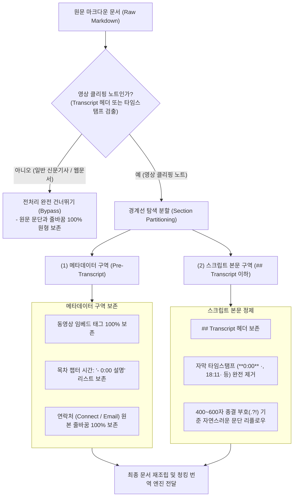

# Video Clipping Note Partitioning & Smart Chunking Technical Guide
### 영상 클리핑 노트 구역 분할 및 스마트 청킹 기술 가이드

본 문서는 **Assistant Emily** 에서 유튜브 영상 자막, 강의 클리핑 노트, 그리고 웹 기사 문서를 처리할 때 원문의 구조와 줄바꿈을 훼손하지 않고 대용량 텍스트를 안정적으로 완역하기 위해 채택한 **구역 분할(Section Partitioning)** 및 **스마트 청킹(Smart Chunking)** 의 공학적 설계 명세를 기술합니다.

---

## 1. 개요 및 설계 배경 (Overview & Engineering Background)

유튜브 요약 확장 프로그램(YouTube Summary, Glasp 등)으로 웹 클리핑된 옵시디언 노트는 일반 마크다운 문서와 근본적으로 다른 복합 구조를 지닙니다:
1. **메타데이터 구역**: 상단 동영상 링크(``), 강의 목차 타임스탬프(`0:00 Intro`, `1:57 BEGINNER`), 발표자 소개 및 연락처(`Connect:`, `Email:`, `Newsletter:`).
2. **스크립트 자막 구역 (`## Transcript`)**: 수초 단위로 파편화된 음성 인식 텍스트와 초 단위 타임스탬프(`**0:00** ·`, `0:27`, `18:11·`).

과거 단순 프롬프트 방식의 치명적 결함:
* 타임스탬프를 지우라고 지시하면, 본문뿐만 아니라 **상단 목차 타임스탬프까지 전부 삭제** 해버림.
* 줄바꿈을 줄이라고 지시하면, **`Connect:` 아래 연락처 목록과 목차가 단 한 줄의 텍스트로 합쳐져 버림**.
* 본문의 자막 분량이 수만 자에 달할 경우, 모델의 출력 컨텍스트(4,096 토큰) 한계로 인해 **뒷부분 80%가 잘린 채 번역이 중단** 됨.

Assistant Emily는 이 문제를 해결하기 위해 문서를 **두 개의 독립 구역으로 물리 분할(Section Partitioning)** 하여 전처리하고, 본문 자막은 **1,800자 스마트 청킹** 으로 안전 분할 번역하는 파이프라인을 구축했습니다.

---

## 2. 영상 클리핑 구역 분할 (Section Partitioning Architecture)

`MarkdownFormatter.cleanScriptTimestamps`는 문서의 시작부터 `## Transcript` 헤더까지를 경계선으로 설정하여 엄격히 이원화 처리합니다.



---

## 3. 일반 웹 기사 vs 영상 클리핑 자동 분기

* **일반 신문기사 및 기술 블로그**:
  * `Transcript` 헤더나 자막 타임스탬프 패턴이 존재하지 않으므로, 전처리 함수는 즉시 입력 텍스트를 그대로 반환(`return text`)합니다.
  * 기사 고유의 짧은 문단, 인용구, 줄바꿈이 단 하나도 손상되지 않습니다.
* **영상 클리핑 노트**:
  * `^#{1,4}\s+Transcript\b` 또는 다중 타임스탬프를 감지하면 구역 분할 엔진이 가동됩니다.
  * 메타데이터 구역의 라인은 원본 줄바꿈을 유지하고, `0:00 What is Gemini Notebook` 형태의 라인은 `- 0:00 What is Gemini Notebook`으로 불릿 리스트화하여 줄바꿈 소실을 방어합니다.

---

## 4. Transcript 대제목 및 구간별 주제(Sub-title) H3 구조화

옵시디언 웹 클리퍼(Obsidian Web Clipper)를 통해 유튜브 영상을 클리핑하면, `Transcript` 영역 내부가 단순 타임스탬프와 음성 전사 텍스트만으로 구성되지 않고 챕터별 소주제(Sub-title)가 중간중간 삽입되어 있습니다:

```markdown
Transcript

75 days left in 2026

0:00 · There are 75 days left in 2026.
0:04 · If you want a real AI skill on your resume...

What changed since June (18 → 27 courses)

0:44 · Quick context, back in June...
```

기존 단순 결합 방식에서는 이러한 주제 라인(`75 days left in 2026`)이 자막 본문 문단 속에 일반 문장처럼 파묻혀 병합되거나 LLM 번역 시 문맥이 왜곡되는 문제가 있었습니다.

**Assistant Emily** 는 2단계 구간 감지 알고리즘을 통해 이를 완벽히 구조화합니다:
1. **Transcript 대제목 표준화**: `Transcript`, `**Transcript**`, `스크립트`, `전사록` 등의 시작 라인을 감지하여 표준 `## Transcript` (H2) 헤딩으로 정합화합니다.
2. **구간별 주제(Sub-title) 자동 감지**:
   * 마크다운 헤딩(`### ...`)이나 볼드체 단독 라인(`**...**`)
   * 타임스탬프로 시작하지 않으면서 바로 다음 유효 라인이 타임스탬프(`0:00 · ...`)로 시작하는 150자 이하의 독립 제목 라인
3. **독립 H3 소제목 변환**: 이전 음성 단락을 즉시 종결 및 출력하고, 해당 주제를 `### 주제명` 형태의 H3 마크다운 헤딩으로 독립 승격시킵니다.

이로써 옵시디언의 우측 아웃라인(Outline) 패널에서 챕터별 즉시 이동이 가능해지며, LLM 번역 시에도 각 주제가 마크다운 헤딩으로 명확히 인식되어 고품질로 번역됩니다.

---

## 5. 자막 타임스탬프 정제 및 문단 리플로우 알고리즘

스크립트 본문 구역에서 `cleanScriptTimestamps`는 다음 알고리즘을 통해 자막 파편을 매끄러운 단락으로 재결합합니다:

```typescript
// 1. 스크립트 타임스탬프 정규식 제거 (**0:00** ·, 0:27:, [00:15], 18:11· 등)
let cleanedLine = line.replace(
  /(?:\*\*|\(|\[)?(?:\d{1,2}:)?\d{1,2}:\d{2}(?::\d{2})?(?:\*\*|\)|\])?\s*(?:[·•・:–—\-|]|&middot;)?\s*/g,
  ' '
);
cleanedLine = cleanedLine.replace(/([.?!])\s+/g, '$1 ').replace(/[ \t]+/g, ' ').trim();

// 2. 자연스러운 문단 호흡: 400~600자 이상이고 문장이 종결(.?!)되었을 때 단락 분할
if (currentScriptLength >= 400 && /[.?!]$/.test(cleanedLine)) {
  cleanedScriptParagraphs.push(currentScriptParagraph.join(' '));
  currentScriptParagraph = [];
  currentScriptLength = 0;
}
```

이 과정을 통해 1초 단위로 끊어져 1,000줄에 달하던 자막 텍스트가 15~20개의 읽기 쉬운 표준 마크다운 문단으로 정돈됩니다.

---

## 6. 1,800자 스마트 청킹 (Smart Chunking Engine)

### 6.1 청킹 임계값 설정 배경 (1,800자)
기존의 2,500자 청킹은 OpenAI GPT-4o와 같은 고용량 모델에서는 안정적이었으나, 다음과 같은 환경에서 간헐적 컨텍스트 절단이 발생했습니다:
* **경량 로컬 모델** (`llama3.2:3b`, `qwen2.5:7b`, Ollama 환경): 출력 토큰 한계(2,048 토큰) 및 캐시 부족.
* **무료 프록시 티어** (`dots-3-note-preview:free`, FreeLLMAPI): 분당 토큰(TPM) 또는 단일 요청 크기 제한.

Assistant Emily는 모든 경량·무료 모델에서도 100% 안전 완역을 보장하기 위해 단일 청크 상한선을 **1,800자** 로 최적화했습니다.

### 5.2 청크 분할 규칙
1. **헤딩 경계 우선 분할**: `# `, `## `, `### ` 헤딩 경계에서 우선 분할하여 문서의 계층적 의미 단위를 유지합니다.
2. **코드 블록 및 콜아웃 보호**: 코드 블록(\`\`\`...\`\`\`)이나 콜아웃 내부에서는 청크를 절대 자르지 않고 블록 외부에서 분할합니다.
3. **문장 단위 안전 분할**: 1,800자를 초과하는 거대 단락의 경우 문장 종결 부호(`. `, `! `, `? `)를 기준으로 안전 분할합니다.

---

## 6. 동영상 임베드 사후 확정 복원 (`ensureVideoEmbedsPreserved`)

대형 언어 모델이 번역 과정에서 상단의 동영상 임베드 태그(``)를 환각이나 서식 오류로 누락하는 경우가 있습니다.

Assistant Emily는 번역 파이프라인 시작 시 원문에서 동영상 링크 및 임베드 태그를 메모리에 보관하고, 번역 완료 후 결과물에 해당 임베드가 누락되었는지를 자동으로 감지합니다:
* 누락 감지 시: 프론트매터 바로 아래 최상단에 **코드 레벨에서 원본 동영상 임베드를 강제 재주입** 합니다.
* 이를 통해 LLM의 변덕과 상관없이 원본 동영상 링크가 100% 영구 보존됩니다.
